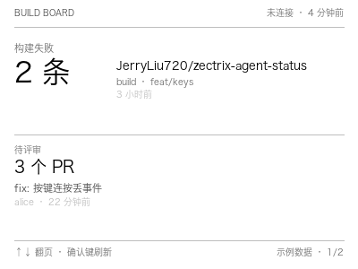
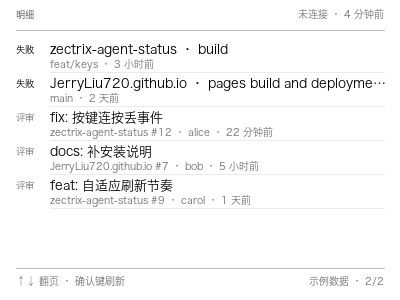

# NOTE4 构建与待评审看板

> 黑白 NOTE4 上显示「我关注的 GitHub 仓库里，哪些 Actions 失败了、哪些 PR 在等我评审」。
> 本地推送应用，不刷机、不走极趣云。





## 画面

**第 1 页 · 概览**：失败几条、待评审几条。有失败时失败在上；全都好就写「构建是绿的，没有待评审」。

**第 2 页 · 明细**：先列失败，再列待评审，每页最多 6 行，多的写「还有 N 条」。

顶栏显示连接状态与上次成功拉取时间。内容没变化不重新推送。

按键：**↑ / ↓ 翻页**，**确认键立刻重新拉取**。

## 数据从哪来

| 内容 | 接口 |
|---|---|
| 最近 7 天失败的 Actions | `GET /repos/{owner}/{repo}/actions/runs?per_page=5`，只留 `conclusion=failure` 且 7 天内 |
| 待我评审的 PR | `GET /search/issues?q=is:pr+is:open+review-requested:@me+repo:{owner}/{repo}` |

Token 只从环境变量 `GITHUB_TOKEN` 或 macOS 钥匙串（服务名 `zectrix-build-board`）读取，权限只需：

- 所选仓库的 **Actions: Read**
- 所选仓库的 **Pull requests: Read**

日志不打印 token。**没有 token 时不访问网络**，改用 `fixture.json` 并在页脚标注「示例数据」。

## 安装

```bash
git clone <本仓库>
cd zectrix-build-board
./install.sh
```

脚本会：检查 Python + Pillow、检查（或安装）Rust、下载 Zectrix 本地推送 SDK 0.1.0、编译推送程序、把 token 交互写入钥匙串、生成两张预览图。

然后编辑 `config.json`：

```json
{
  "repos": ["owner/repo-a", "owner/repo-b"],
  "interval": 300
}
```

`repos` 最多 10 个，空列表则一直用示例数据。

## 推送

先确认预览图没问题，再连设备：

```bash
python3 board.py --daemon
./pusher/target/release/build-board-pusher <设备IP> status.png
```

- 设备 IP 在 NOTE4 **「设置 → 网络」** 查看
- 需在设备上开启 **「待机保持 Wi-Fi」**（程序不改固件）
- 同一台设备已有别的本地推送进程时会报告 **Busy** 并退出，本程序不会去杀进程
- 断开后不自动重连，重新运行命令即可

## 交给 AI 安装

把下面这段交给电脑上的 AI（Claude Code / Codex / Cursor 均可）：

```
请在本机安装 GitHub 仓库 <owner>/zectrix-build-board。

1. 先读 README 与 install.sh，确认它只需要 Python 3 + Pillow + Rust，
   不会刷写设备固件、不会注册开机自启、不会自动推送。
2. 在仓库目录执行 ./install.sh。若缺少 Pillow 用 pip 安装；缺少 Rust 用 rustup。
3. 按我的仓库列表编辑 config.json（repos 最多 10 个，owner/name 格式）。
4. 运行 python3 board.py --preview，把 preview-1.png 和 preview-2.png 给我看。
   注意确认：没有 token 时页脚应显示「示例数据」。
5. 我说可以之后，再运行：
   python3 board.py --daemon
   ./pusher/target/release/build-board-pusher <设备IP> status.png
   设备 IP 我会在 NOTE4「设置 → 网络」里查到后告诉你。
6. 如果推送报 Busy，不要杀其他进程，停下来告诉我。
```

## 结构

```
board.py              拉取 + 渲染 + daemon
fixture.json          无 token 时的示例数据
config.example.json   仓库列表与轮询秒数（不含 token）
pusher/               只负责推图与按键的本地程序（路径依赖 SDK）
tests/test_board.py   数据整理与渲染尺寸测试（不连网、不连设备）
install.sh            安装脚本
```

## 已知限制

- 只支持黑白 NOTE4，配套固件 3.7.2；固件不符时请停下，不要升级
- 只验证 macOS（Apple Silicon），Windows / Linux 未验证
- 不自动重连；设备断开后需重新运行推送命令
- 无 token 时是示例数据，不会请求 GitHub
- 失败只统计最近 7 天、每个仓库最近 5 次运行

## 测试

```bash
python3 -m unittest tests/test_board.py
```

不访问网络、不连接设备。

## License

MIT。
